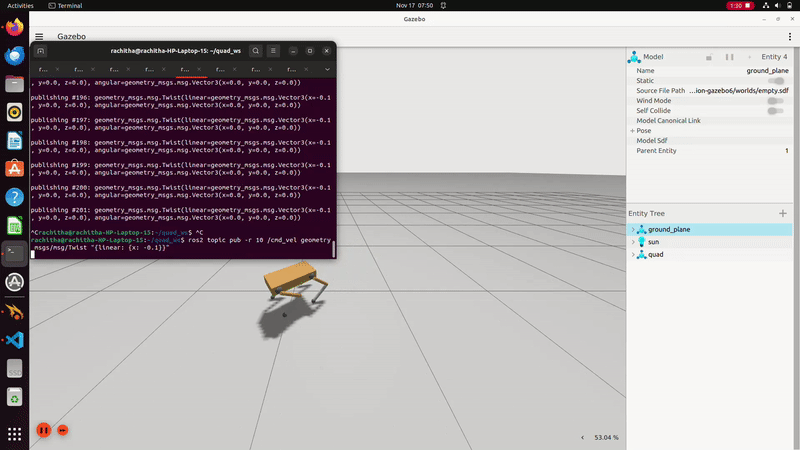
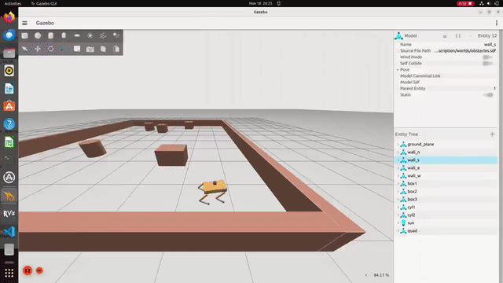

# Quadruped Robot: LiDAR Obstacle Avoidance (ROS 2 Humble + Gazebo Fortress)

A 12-DOF quadruped robot built from scratch in ROS 2. It uses a custom trot gait and inverse kinematics, and walks autonomously around obstacles using a 2D LiDAR.

Full video (Gazebo + RViz): [assets/demo_lidar.mp4](assets/demo_lidar.mp4)

## Features
- Custom 12-joint quadruped model (URDF/xacro) with `ros2_control`
- Own leg inverse kinematics and trot gait (`kinematics.py`, `gait.py`)
- Velocity control: the `walker` node turns `/cmd_vel` (forward, backward, turning) into joint trajectories
- 2D LiDAR (Gazebo `gpu_lidar`, 180 samples over 180 degrees, 10 Hz, 0.15 to 5 m) bridged to `/scan`
- Reactive obstacle avoidance: the `avoid` node reads `/scan` and publishes `/cmd_vel`
- Obstacle arena world (walls, boxes and cylinders)

## How it works

    LiDAR (/scan) -> avoid.py -> /cmd_vel -> walker.py -> joint trajectories -> Gazebo

`avoid` splits the scan into front, left and right sectors. It walks forward, steers away from close sides, and turns in place toward the more open side when something is directly ahead. Hip abduction joints are held at zero during walking; the thigh and knee joints do the walking.

## Requirements
- Ubuntu 22.04, ROS 2 Humble, Gazebo Fortress (Ignition Gazebo 6)
- `ros_gz_sim`, `ros_gz_bridge`, `gz_ros2_control`, `ros2_controllers`, `xacro`

## Build

    mkdir -p ~/quad_ws/src && cd ~/quad_ws/src
    git clone <this-repo-url> quad_description
    cd ~/quad_ws && colcon build --packages-select quad_description
    source install/setup.bash

## Run (three terminals)

1. Simulation, robot and obstacle arena:

        ros2 launch quad_description gazebo.launch.py

2. Walker (velocity commands to leg motion):

        ros2 run quad_description walker

3. Autonomous obstacle avoidance:

        ros2 run quad_description avoid

To drive it manually instead of `avoid`:

    ros2 topic pub -r 10 /cmd_vel geometry_msgs/msg/Twist "{linear: {x: 0.05}}"

## Tuning
`avoid` parameters: `speed`, `turn`, `stop_dist`, `clear_dist`. For example:
`ros2 run quad_description avoid --ros-args -p speed:=0.1 -p stop_dist:=0.8`

## Future work
- SLAM and Nav2 goal navigation
- IMU-based body leveling
- Porting to a physical 12-DOF quadruped
